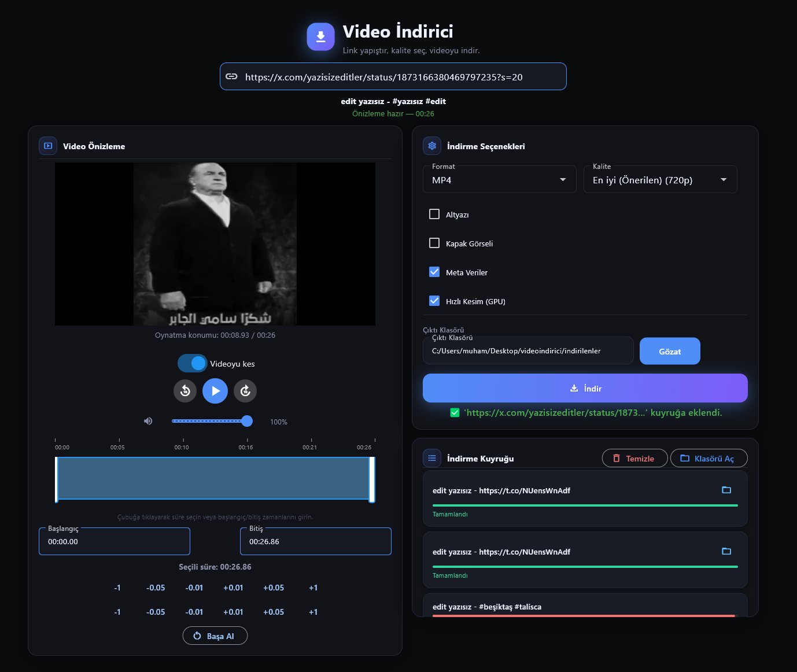

# 🎞️ Video İndirme Aracı

### Önizle, kes, indir

YouTube, TikTok, Instagram ve Twitter'dan video indirebileceğin masaüstü uygulaması

-2E7D32?style=flat-square)

 

---

## 📖 Hakkında

Python ve Flet kullanarak geliştirdiğim masaüstü video indirme aracı. Desteklenen platformlardan bir bağlantıyı yapıştırman yeterli: video uygulamanın içinde önizlenir, istersen yalnızca beğendiğin sahneyi keserek indirebilir, çözünürlüğü kendin seçebilirsin.

Uygulama tek bir `.exe` dosyası olarak paketlendi; Python ya da başka bir bileşen kurmaya gerek kalmadan doğrudan çalışır.

## ✨ Özellikler

| | Özellik | Açıklama |
|:-:|---|---|
| 🔗 | **Bağlantıyla indirme** | YouTube, TikTok, Instagram ve Twitter bağlantılarını yapıştır, indir |
| 👀 | **Uygulama içi önizleme** | İndirmeden önce videoyu uygulamanın içinde izle |
| ✂️ | **Sahne kesme** | Videonun tamamı yerine sadece istediğin aralığı indir |
| 🎚️ | **Çözünürlük seçimi** | İndirme kalitesini ihtiyacına göre ayarla |
| 📦 | **Kurulumsuz** | Tek `.exe` dosyası, doğrudan çalışır |

## 🖼️ Ekran görüntüleri

<table>
<tr>
<td width="50%"></td>
<td width="50%"></td>
</tr>
</table>

## 🛠️ Teknik yapı

| Alan | Kullanılan |
|---|---|
| Dil | Python |
| Arayüz | Flet |
| İndirme motoru | yt-dlp |
| Dağıtım | Tek dosya Windows `.exe` |

---

🔒 Bu depo yalnızca projenin tanıtımı içindir; kaynak kodu paylaşılmamaktadır.

**[tetik.dev](https://tetik.dev/projects.html)** · Muhammed Ali Tetik

